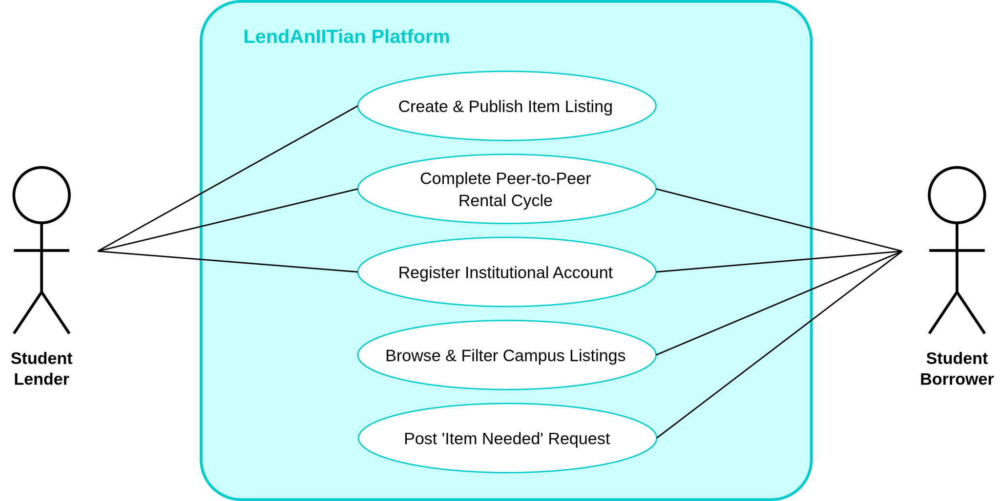

# Product Backlog

## Team Information

- Team name: Team GGRK
- Project title: LendAnIITian
- Primary user group for the first release: Student Borrowers and Student Lenders (MSU-IIT Student Community)
- Format: User stories with one use case

| Member | GitHub username | Personal CSC181 repository |
|---|---|---|
| Sean Jric B. Gabor | gitnsaen | [gitnsaen](https://github.com/gitnsaen/csc181) |
| Luke Ryan C. Ruaya | vyleene | [vyleene](https://github.com/vyleene/csc181) |
| Kelvin Chris S. Gomez | KelvinGrim | [KelvinGrim](https://github.com/KelvinGrim/CSC181) |
| Joshua Khent G. Kenezo | sadcattoo | [sadcattoo](https://github.com/sadcattoo/csc181) |


## 1. Interview Summary

| Code | Stakeholder role | Date | Method | Interviewer(s) |
|---|---|---|---|---|
| V1 | Student borrower/lender, 2nd-year BPEd | 2026-10-23 | In person | Sean Jric B. Gabor |
| V2 | Student borrower/lender, 2nd-year BA Sociology | 2026-10-23 | In person | Sean Jric B. Gabor |
| V3 | Student borrower/lender, 3rd-year BS Pharmacy | 2026-10-25 | Online video call | Luke Ryan C. Ruaya |
| V4 | Student borrower/lender, 3rd-year BS METE | 2026-10-25 | Online chat | Kelvin Chris S. Gomez |


## 2. From Interview Notes to Needs

| ID | Source | What we heard or saw | Underlying need | Requirement idea | Type |
|---|---|---|---|---|---|
| F1 | V1, V2 | V1 had to resort to physical ukay-ukay stores for presentation attire because MSU-IIT CATS posts lacked structured search filters; V2 found online searching difficult because posts lacked sizing context. | A centralized, categorized discovery channel for peer-owned items on campus. | Item catalog search with category, size, and rate filters. | F |
| F2 | V1, V2 | V1 worried about damage to a sentimental Bridgerton dress; V2 suffered unreturned clothing and "ghosting" when lending through casual social media direct chats. | Accountability, verifiable identity, and transparent return tracking. | Structured borrowing requests, lender approval workflow, and return due date tracking. | F |
| F3 | V1 | V1 stated: "if ever magpahulam ko magpabayad jud ko kay aron naay 'collateral' arun pud mahadlok makaguba ba." | Clear financial terms and mutual commitments prior to handing over items. | Listing rate fields (daily/weekly) and optional security deposit condition notes. | F |
| F4 | V3, V4 | V3 hesitated to lend a laptop because the borrower lacked operating knowledge; V4 worried pristine, unmarked textbooks would deteriorate if mishandled. | Setting clear equipment expectations, usage guidelines, and condition transparency. | Listing creation with mandatory item condition tags, handling instructions, and item photos. | F |
| F5 | V2, V4 | V2 refused lending requests conducted purely over casual chat; V4 noted that lending only feels safe when borrowers are verified and known to care for belongings. | Verified community membership and designated institutional exchange safety. | Restricted registration using institutional @g.msuiit.edu.ph email and on-campus meetup selection. | C |
| F6 | V2 | V2 stated that as an out-of-town student with few campus acquaintances, he was forced to spend ₱1,200 on a single-use shirt because he had no local network to borrow from. | Equal item discovery across academic departments regardless of personal social circles. | Public campus-wide browse and search view accessible to all enrolled students. | F |
| F7 | V1, V4 | V1 bought a scientific calculator used only for a single exam; V4 bought welding PPE (earmuffs, apron, steel-toe shoes) that went completely unused during class. | Discovering short-term academic requirements and borrowing course materials before committing to retail purchases. | Academic course tagging and subject categorization on listings. | F |
| F8 | V3 | V3 scrambled on Shopee and spent ₱1,000 on a Malaysian costume for a single ASEAN day event because no physical store or listing had it available. | A reverse-discovery channel to request niche or unlisted items directly from peers. | An "Item Needed" request board where students broadcast urgent borrowing needs. | F |

### Assumption log

| ID | Assumption | Risk if wrong (High/Medium/Low) | How we will check it |
|---|---|---|---|
| A1 | Enrolled students possess idle academic and personal items they are willing to lend to peers for small fees or goodwill. | High | Survey campus residents and pre-seed at least 20 verified student listings during pilot testing. |
| A2 | Institutional email verification (@g.msuiit.edu.ph) provides sufficient trust to deter item theft and intentional damage without platform monetary escrow. | High | Monitor return compliance and user dispute frequency across the initial 15 completed transactions. |
| A3 | Physical exchanges can be reliably conducted at designated public campus landmarks without requiring in-app GPS tracking. | Low | Validate chosen meetup locations (e.g., Library lobby, Student Center) during initial user walkthroughs. |

## 3. User Stories

| ID | User story | Source finding(s) | Epic | INVEST check |
|---|---|---|---|---|
| US-01 | As a student borrower, I want to filter listings by category and size, so that I can quickly pinpoint gear that fits my physical and course requirements. | F1, F7 | Discover Inventory | Yes |
| US-02 | As a student borrower, I want to search listings by keyword, so that I can locate specific items needed for immediate academic use without scrolling through unrelated posts. | F1 | Discover Inventory | Yes |
| US-03 | As an out-of-town student, I want to browse all campus listings across all colleges, so that I can access equipment without relying on an existing personal friend network. | F6 | Discover Inventory | Yes |
| US-04 | As a student lender, I want to create an item listing with photos, category, and daily rental rates, so that peers can discover my idle belongings. | F1, F3 | Manage Listings | Yes |
| US-05 | As a student lender, I want to specify item condition and handling instructions on my listing, so that borrowers know how to care for my equipment and avoid damage. | F4 | Manage Listings | Yes |
| US-06 | As a student borrower, I want to submit a rental request specifying my borrowing purpose and dates, so that the lender understands why and when I need the item. | F2, F5 | Borrowing Workflow | Yes |
| US-07 | As a student lender, I want to review a borrower's purpose and requested timeframe before approving or declining, so that I maintain control over who handles my property. | F2, F5 | Borrowing Workflow | Yes |
| US-08 | As a student lender, I want to update the rental lifecycle status (e.g., Handed Over, Returned), so that both parties have visibility over active and completed loans. | F2 | Borrowing Workflow | Yes |
| US-09 | As a student lender, I want to receive a notification 24 hours before an item is due, so that I can prepare for return without having to manually chase the borrower. | F2 | Borrowing Workflow | Yes |
| US-10 | As a student borrower, I want to select a mutually recognized campus meetup landmark during request submission, so that our physical handoff occurs in a safe environment. | F5 | Borrowing Workflow | Yes |
| US-11 | As a student borrower, I want to post an "Item Needed" request for items not currently listed, so that peers who own them can offer them for rent. | F8 | Community Request Board | Yes |
| US-12 | As a student user, I want to register and sign in exclusively using my @g.msuiit.edu.ph institutional email, so that I can be confident I am transacting with verified university peers. | F5 | Platform Onboarding | Yes |

### Epics and how we split them

| Epic | Split into | How we split it |
|---|---|---|
| Discover Inventory | US-01, US-02, US-03 | By variation in search mechanism and user discovery scope |
| Manage Listings | US-04, US-05 | By data specification (basic listing attributes vs. usage constraints) |
| Borrowing Workflow | US-06, US-07, US-08, US-09, US-10 | By chronological workflow step (request → decision → exchange location → status tracking → reminder) |
| Community Request Board | US-11 | By role direction (reverse discovery for unlisted inventory) |
| Platform Onboarding | US-12 | By security boundary and access control rule |

### Stories we rewrote


1. Before: As a student, I want to view all available items on the platform, so that I can borrow what I need.

   After: As an out-of-town student, I want to browse all campus listings across all colleges, so that I can access equipment without relying on an existing personal friend network.
   
   Reason: This was not valuable. It is too vague and states a general purpose. By specifying which student it is, you know who will benefit the most. The new benefit explains why this is a problem by stating that new students don't have a network to borrow from (F6) which was the issue in V2.
2. Before: As a student lender, I want to get reminders about my lent items, so that I know when they are due.

   After: As a student lender, I want to receive a notification 24 hours before an item is due, so that I can prepare for return without having to manually chase the borrower.
   
   Reason: This is not Valuable nor Testable. "Reminders" do not prevent ghosting and forgotten returns (F2) as it is the borrowers fault that they are being forgotten. There is also no mention of specific time before the return date for the "reminder". However, the After informs both parties when the item is due, notifies them explicity 24-hours ahead of time, which makes it testable.

## 4. Acceptance Criteria

### US-01: Search and filter items by category (Must-have)

Acceptance criteria:

- [ ] Selecting a category filter (Costumes, Academic Electronics, Lab Gear, Event Attire) restricts the catalog feed to display only items assigned to that category within 2 seconds.
- [ ] Selecting a clothing size filter (XS, S, M, L, XL) restricts visible costume and apparel listings to items with the matching size tag.
- [ ] (unhappy) When the selected category and size combination contains zero matching active listings, the system displays "No listings match your selected filters" while preserving the active filter controls.

Scenario 1 : Normal Case
```gherkin
Given the catalog contains three active listings: "Scientific Calculator" in Academic Electronics, "Red Trousers" in Costumes (Size M), and "Welding Apron" in Lab Gear (Size L)
When a student borrower selects the category "Costumes" and size "M"
Then only "Red Trousers" is displayed in the catalog feed
```
Scenario 2 : Unhappy path
```gherkin
Given the catalog contains listings in Costumes with sizes S and M only
When a student borrower selects the category "Costumes" and size "XL"
Then the system displays "No listings match your selected filters" and keeps the filter sidebar visible
```

Acceptance criteria:

- [ ] Registration requires an email ending in "@g.msuiit.edu.ph".
- [ ] Sends a verification link to the provided email.
- [ ] (unhappy) If a user enters a generic email (like @gmail.com), the system blocks registration.

Scenario 1: Normal case

```gherkin
Given a new student borrower is on the registration page
When they enter "student@g.msuiit.edu.ph" and submit
Then the system creates a pending account and emails a verification link
```

Scenario 2: Unhappy path

```gherkin
Given a new student borrower is on the registration page
When they enter "student@yahoo.com" and submit
Then the system blocks registration and displays "Only MSU-IIT institutional emails are allowed."
```

### US-02: Search listings by keyword (Must-have)

Acceptance criteria:

- [ ] The search bar matches text queries against listing titles and descriptions, returning matching results within 2 seconds.
- [ ] Search queries are case-insensitive and match partial alphanumeric strings with a minimum length of 3 characters.
- [ ] (unhappy) When a search query yields zero matches, the system displays "No items found for '[query]'" and displays a direct button labeled "Post an Item Needed Request".

Scenario 1 : Normal Case
```gherkin
Given an active listing exists with title "Casio FX-991EX Scientific Calculator"
When a student borrower enters "calculator" into the search bar and presses Enter
Then "Casio FX-991EX Scientific Calculator" is displayed in the search results within 2 seconds
```
Scenario 2 : Unhappy path
```gherkin
Given no listings in the database contain the word "malaysian"
When a student borrower enters "malaysian" into the search bar
Then the system displays "No items found for 'malaysian'" and presents a button labeled "Post an Item Needed Request"
```
### US-03: Browse all campus listings across all colleges (Should-have)

Acceptance criteria:

- [ ] The default catalog feed displays active, approved listings across all university colleges sorted chronologically with newest listings first.
- [ ] Each listing card displays the item title, daily rental rate in PHP, college affiliation of the lender, and an "Available" badge.
- [ ] (unhappy) When an unauthenticated visitor attempts to view full listing details, the system redirects the user to the institutional login page with the notice "Please sign in with your @g.msuiit.edu.ph account to view full listing details".

### US-04: Create an item listing with photos, category, and daily rental rates (Must-have)

Acceptance criteria:

- [ ] The listing creation form requires an item title (5 to 80 characters), category selection, at least one uploaded photograph (JPEG/PNG up to 5 MB), and a numeric daily rental rate in PHP.
- [ ] The daily rental rate input accepts numeric integers greater than or equal to 0 (where 0 indicates free peer sharing).
- [ ] (unhappy) When a lender attempts to submit a listing without uploading an image or inputs a negative rental rate, the system blocks publication, borders the invalid fields in red, and displays specific error messages.

Scenario 1: Normal case
```gherkin
Given a verified student lender is on the "Create Listing" page
When they enter "Bridgerton Regency Ball Gown", select category "Costumes", input a daily rate of "150", upload 1 valid photo, and click "Publish Listing"
Then the listing is published with status "Available" and appears in the public campus catalog
```

Scenario 2: Unhappy path
```gherkin
Given a verified student lender is on the "Create Listing" page
When they enter "-50" into the daily rental rate field and click "Publish Listing"
Then the system blocks form submission, highlights the rate field in red, and displays "Rental rate cannot be negative"
```

### US-05: Specify item condition and handling instructions on listing (Should-have)

Acceptance criteria:

- [ ] The listing form provides a condition selector with predefined options: "Pristine / Like New", "Good Condition", and "Fair / Well-Used".
- [ ] The listing details page displays the lender's custom handling instructions (maximum 500 characters) outlining specific care or cleaning requirements.
- [ ] (unhappy) When a lender inputs text exceeding 500 characters in the handling instructions field, the form displays a character limit counter warning "Maximum 500 characters allowed" and disables the submission button until the text is shortened.

### US-06: Submit a rental request specifying borrowing purpose and dates (Must-have)

Acceptance criteria:

- [ ] The rental request form requires the borrower to select a start date, return due date, and enter an explanation of borrowing purpose with a minimum length of 15 characters.
- [ ] The return due date must be equal to or later than the start date, and the start date cannot be earlier than the current calendar date.
- [ ] (unhappy) When a borrower attempts to submit a request with a return date earlier than the start date or provides fewer than 15 characters in the purpose field, the system halts submission and displays inline validation notices.

Scenario 1: Normal case
```gherkin
Given an active listing "Casio FX-991EX Scientific Calculator" with status "Available"
When a borrower selects dates from Nov 15 to Nov 16, enters purpose "Final examination in MAT061", and submits
Then the system creates a request with status "Pending" and notifies the item lender
```

Scenario 2: Unhappy path
```gherkin
Given a borrower is requesting a lab gown for Nov 20, 2026
When the borrower enters a return due date of Nov 18, 2026 and clicks "Submit Request"
Then the system rejects the submission and displays "Return date must be on or after the start date"
```
### US-07: Review a borrower's purpose and requested timeframe before approving or declining (Must-have)

Acceptance criteria:

- [ ] The lender's dashboard displays each pending request showing the borrower's full name, degree program, borrowing purpose, requested dates, and proposed meetup location.
- [ ] The lender interface provides distinct action buttons labeled "Approve" and "Decline" for each pending request.
- [ ] (unhappy) When a lender clicks "Decline", the system requires selecting a decline reason from a dropdown ("Item unavailable for selected dates", "Incompatible handling requirements", or "Other") before finalizing the decline.

Scenario 1: Normal case
```gherkin
Given a student lender has a pending request from a verified peer for "Red Trousers"
When the lender reviews the purpose "GAAP Semester Opener Performance" and clicks "Approve"
Then the request status transitions to "Approved", the item listing status updates to "Reserved", and the borrower receives an approval notification
```

Scenario 2: Unhappy path
```gherkin
Given a student lender chooses to decline a pending borrowing request
When the lender clicks "Confirm Decline" without selecting a decline reason from the dropdown
Then the system disables the confirmation action and displays "Please select a reason for declining this request"
```

### US-08: Update rental lifecycle status (Handed Over, Returned) (Must-have)

Acceptance criteria:

- [ ] The lender can advance an "Approved" request to "Handed Over" after completing the physical exchange.
- [ ] The lender can advance a "Handed Over" request to "Returned" once the item has been inspected and returned to their custody.
- [ ] (unhappy) When an item remains in "Handed Over" status past 23:59 on the agreed return due date without being marked "Returned", the system automatically flags the transaction badge as "Overdue".

Scenario 1: Normal case
```gherkin
Given an active loan for "Scientific Calculator" has status "Handed Over" and the borrower returns the device
When the lender inspects the device and clicks "Mark as Returned"
Then the transaction status updates to "Returned" and the item listing status resets to "Available"
```

Scenario 2: Unhappy path
```gherkin
Given an item loan has an agreed return due date of Nov 13, 2026
When the system clock reaches Nov 14, 2026 at 00:00 without the lender confirming return
Then the transaction status label changes from "Handed Over" to "Overdue" highlighted in red
```
### US-09: Receive a notification 24 hours before an item is due (Should-have)

Acceptance criteria:

- [ ] The system dispatches an automated in-app notification and email to both borrower and lender exactly 24 hours prior to the scheduled return due date.
- [ ] The notification message explicitly includes the item name, return due date, agreed meetup location, and lender contact details.
- [ ] (unhappy) When the notification dispatch service fails due to server network timeouts, the system logs the failure and retries transmission within 30 minutes.

### US-10: Select a campus meetup location from a safe predefined list (Must-have)

Acceptance criteria:

- [ ] The rental request form provides a dropdown menu containing verified campus exchange landmarks: "University Library Lobby", "Rizal Park", "CSM Building Lobby", "CASS Student Lounge", and "CED Canteen".
- [ ] The agreed meetup location is permanently displayed on both the borrower's and lender's active transaction detail cards.
- [ ] (unhappy) When a borrower attempts to submit a rental request without selecting a location from the predefined dropdown, the system halts submission and displays "Please select a designated campus meetup location".

Scenario 1: Normal case
```gherkin
Given a borrower is completing a rental request form for a lab gown
When they select "CSM Building Lobby" from the designated meetup dropdown and submit
Then the request records "CSM Building Lobby" as the exchange location on the lender's review screen
```

Scenario 2: Unhappy path
```gherkin
Given a borrower leaves the campus meetup dropdown in its default unselected state ("[Select Campus Landmark]")
When the borrower clicks "Submit Rental Request"
Then the system highlights the dropdown field with a red border and displays "Please select a designated campus meetup location"
```

### US-11: Post an "Item Needed" request on the community board (Should-have)

Acceptance criteria:

- [ ] The "Item Needed" board displays a public list of active student item requests showing item title, needed dates, purpose/course, and requesting student's college.
- [ ] Verified students can submit a request posting with title (5 to 80 characters), needed date, and description (minimum 15 characters).
- [ ] (unhappy) When a student attempts to submit an item request with a needed date set prior to the current calendar date, the system rejects the submission and displays "Needed date cannot be in the past".

### US-12: Register and sign in exclusively using @g.msuiit.edu.ph institutional email (Must-have)

Acceptance criteria:

- [ ] Account registration requires an email address strictly ending in the "@g.msuiit.edu.ph" domain.
- [ ] The registration system sends a secure one-time activation link to the student's institutional email address to verify domain ownership.
- [ ] (unhappy) When a user enters an email address with any domain other than "@g.msuiit.edu.ph" (such as @gmail.com or @yahoo.com), the system blocks registration and displays "Registration is strictly restricted to valid @g.msuiit.edu.ph institutional student accounts".

Scenario 1: Normal case
```gherkin
Given a new student user visits the registration page
When they input "carlo.alvarez@g.msuiit.edu.ph" and click "Register"
Then the system creates a pending profile and dispatches an activation link to carlo.alvarez@g.msuiit.edu.ph
```

Scenario 2: Unhappy path
```gherkin
Given a user visits the registration page
When they enter "student123@gmail.com" and click "Register"
Then the system halts the form submission and displays "Registration is strictly restricted to valid @g.msuiit.edu.ph institutional student accounts"
```

## 5. Quality Requirements and Constraints (EARS)

| ID | Requirement | EARS pattern | Type | Source | Number agreed with |
|---|---|---|---|---|---|
| NFR-01 | When a borrower applies a category or search filter, the system shall show the matching listing results within 2.0 seconds over a standard H+ or 4G mobile data connection. | Event-driven | Quality | F1, F6 | V1, V2 |
| NFR-02 | While the web application is unable to reach the server due to client network disconnection, the system shall disable transactional submission buttons and display an explicit offline notice preventing duplicate request creation.| State-driven | Quality | F2 | V1, V2 |
| NFR-03 | The system shall restrict account creation exclusively to verified "@g.msuiit.edu.ph" institutional email addresses and mask student contact details until a rental request is mutually approved. | Ubiquitous | Constraint | F5, F8 | V1, V2 |

## 6. Use Case

### Use-case diagram

The diagram below defines the system boundary for the LendAnIITian responsive web platform, mapping external student actors to their transactional interactions.


### UC-01: Complete Peer-to-Peer Rental and Return Cycle

| Field | Description |
|---|---|
| Primary actor | Student Borrower |
| Supporting actor | Student Lender |
| Precondition | 1. Both borrower and lender have registered and activated their accounts using valid `@g.msuiit.edu.ph` email addresses.<br>2. The lender has published an item listing currently marked with status `"Available"`.<br>3. The borrower is authenticated and viewing the listing details page. |
| Main success scenario | 1. Borrower initiates the transaction by clicking "Request to Borrow" on the listing details page.<br>2. Borrower specifies the required start date, return due date, inputs a detailed borrowing purpose (minimum 15 characters), and selects a designated campus meetup location from the dropdown menu (e.g., "CSM Building Lobby").<br>3. Borrower submits the request; system validates input fields, assigns transaction status `"Pending"`, logs the request timestamp, and dispatches a notification to the lender.<br>4. Lender accesses their dashboard, inspects the borrower's institutional profile, purpose, and requested timeframe, and clicks "Approve".<br>5. System transitions the transaction status to `"Approved"`, updates the item listing badge to `"Reserved"`, and reveals off-platform contact details (institutional email) to both parties to facilitate meetup coordination.<br>6. Borrower and lender convene at the selected campus landmark; after physical handover and mutual inspection, lender accesses the platform and marks the transaction as `"Handed Over"`.<br>7. System transitions the transaction status to `"Handed Over"`, activates return due date tracking, and schedules a 24-hour return reminder notification.<br>8. Prior to deadline expiration, borrower and lender meet at the agreed campus location to return the item; lender inspects item condition and clicks "Mark as Returned".<br>9. System records transaction status as `"Returned"`, archives the completed rental record, resets the item listing status back to `"Available"`, and increments both users' completed exchange counters. |
| Extensions | **2a. Borrower specifies an invalid timeframe or leaves purpose inadequate:**<br>&nbsp;&nbsp;&nbsp;&nbsp;1. System detects return date prior to start date, a start date in the past, or purpose text under 15 characters.<br>&nbsp;&nbsp;&nbsp;&nbsp;2. System prevents submission, highlights offending fields in red, and prompts corrective input.<br>**2b. Requested timeframe overlaps an existing approved reservation:**<br>&nbsp;&nbsp;&nbsp;&nbsp;1. System flags the schedule conflict and informs the borrower that the item is reserved for those dates.<br>**4a. Lender declines the borrowing request:**<br>&nbsp;&nbsp;&nbsp;&nbsp;1. Lender clicks "Decline" and selects a mandatory decline reason from the dropdown.<br>&nbsp;&nbsp;&nbsp;&nbsp;2. System transitions request status to `"Declined"`, releases the item hold, and notifies the borrower.<br>**4b. Lender fails to respond within 48 hours:**<br>&nbsp;&nbsp;&nbsp;&nbsp;1. System automatically flags the pending request as `"Expired"`, releases temporary holds, and notifies the borrower.<br>**6a. Either party fails to appear at the scheduled campus meetup:**<br>&nbsp;&nbsp;&nbsp;&nbsp;1. Transaction remains in `"Approved"` status until either party selects "Cancel Meetup" with an explanatory note, reverting the listing to `"Available"`.<br>**8a. Item is not confirmed returned past 23:59 on the agreed return due date:**<br>&nbsp;&nbsp;&nbsp;&nbsp;1. System transitions transaction status badge to `"Overdue"` highlighted in red.<br>&nbsp;&nbsp;&nbsp;&nbsp;2. System dispatches urgent email reminders to both parties and displays an overdue alert banner on their respective dashboards until the lender marks the item as `"Returned"`.  |
| Postcondition | The borrowed item is safely returned to the lender's custody, the transaction is archived with full audit timestamps, and the item listing is restored to `"Available"` in the campus catalog without administrative intervention. |
| Stories covered | US-06 (Submit rental request), US-07 (Review/Approve request), US-08 (Update lifecycle status), US-10 (Select campus meetup location). |

## 7. Story Map

|  | 1. Onboard & Verify | 2. List & Supply Gear | 3. Discover & Evaluate | 4. Coordinate Exchange | 5. Track & Fulfill Return |
|---|---|---|---|---|---|
| **Release 1 (MVP)** | **US-12:** Institutional Email Registration (`@g.msuiit.edu.ph`) | **US-04:** Create Item Listing with Photos & Rental Rates | **US-01:** Filter Listings by Category & Size <br><br> **US-02:** Keyword Search Bar | **US-06:** Submit Rental Request with Purpose & Dates <br><br> **US-07:** Lender Review & Approve/Decline <br><br> **US-10:** Predefined Campus Meetup Landmark | **US-08:** Update Rental Lifecycle Status *(Handed Over, Returned, Overdue)* |
| **Release 2** <br> *(Sprint 2 Target)* | *Inherits Release 1 verification* | **US-05:** Specify Condition & Handling Instructions | **US-03:** Browse All Campus Listings Across Colleges <br><br> **US-11:** Post "Item Needed" Community Request Board | *Inherits Release 1 workflow* | **US-09:** Automated 24-Hour Return Reminder Notification |
| **Later** <br> *(Post-MVP)* | Department & org affiliation badges | Bulk listing management & archive | Automated peer match alerts | Direct in-app meetup rescheduling | Item damage dispute logging & peer rating history |


## 8. The Ordered Backlog

[List every story in one order, highest priority first, with no ties. See Week 4, slides 26–28.]

| Rank | Story | MoSCoW | Size (S/M/L) | Value / effort quadrant | Sprint |
|---|---|---|---|---|---|
| 1 | US-12: Institional Email Registration | Must | M | Big bet | Sprint 1 |
| 2 | US-04: Create Item Listing with Photos & Rental Rates | Must | M | Big bet | Sprint 1 |
| 3 | US-01: Filter listings | Must | S | Quick win | Sprint 1 |
| 4 | US-02: Keyword search | Must | S | Quick win | Sprint 1 |
| 5 | US-10: Select Predefined Campus Meetup Landmark | Must | S | Quick win | Sprint 1 |
| 6 | US-06: Submit Rental Request with Purpose and Dates | Must | M | Big bet | Sprint 1 |
| 7 | US-07: Review Borrower Purpose & Approve/Decline Request | Must | S | Quick win | Sprint 1 |
| 8 | US-08: Update Rental Lifecycle Status | Must | M | Big bet | Sprint 1 |
| 9 | US-03: Browse All Campus Listings Across Colleges | Should | S | Quick win | Sprint 2 |
| 10| US-05: Specify Item Condition and Handling Instructions | Should | S | Quick win | Sprint 2 |
| 11| US-11: Post "Item Needed" Request on Community Board | Should | M | Big bet | Sprint 2 |
| 12| US-09: Automated 24-Hour Return due Date Reminder | Should | M | Big bet | Sprint 2 |
| 13| *Out-of-Scope:* In-App Rental Payments | Won't | L | Time sink | Not this time |
| 14| *Out-of-Scope:* Automated Damage Dispute Arbitration System | Won't | L | Time sink | Not this time |
| 15| *Out-of-Scope:* Campus Courier & Third-Party Delivery Integration | Won't | L | Time sink | Not this time |

### How we ordered it

When structuring our backlog, we recognized the need to resolve hard technical dependencies first, ensuring we reduce operational risk from the start. As such, we positioned institutional authentication (US-12) and listing creation (US-04) at the very top because verified identity establish the peer trust demanded by stakeholders like V2 and V4, while having an active supply of listings is the foundational prerequisite for any borrowing activity to even occur. From there, we immediately followed with category filtering (US-01) and keyword search (US-02) as high-value quick wins; this directly addresses the catalog discovery deficit noted by V1. Thus, by sequentially completing our transactional core to build the walking skeleton in Sprint 1, we ensure that major risks like ghosting and overdue rentals are structurally prevented before we move on to secondary community features (US-03, US-05, US-11, US-09) in Sprint 2.

### Capacity check

| Question | Answer |
|---|---|
| How many Must-have stories, and their total size? | There are 8 Must-have stories, consisting of 4 Small (S) stories (US-01, US-02, US-07, US-10) and 4 Medium (M) stories (US-12, US-04, US-06, US-08). Total estimated effor: ~16 to 18 days across our 4-person team. |
| Do the Must-haves fit in about 60% of our time for two sprints? | Yes. With 4 developers across two 2-week iterations (Sprint 1 and Sprint 2), our total team capacity is approximately 32 days. The 8 Must-have stories represent ~56% of this total capacity, safely below the 60% threshold and leaving enough time for reviews, testing, bug fixes, and all four Sprint 2 Should-have stories (US-03, US-05, US-11, US-09).|
| Do the Release 1 stories form one complete path through the core workflow? | Yes. As validated in Section 7 (Story Map), the 8 Must-have stories establish a complete path across all five stages of the user journey: Onboard (US-12) → Supply (US-04) → Discover (US-01, US-02) → Coordinate (US-06, US-07, US-10) → Return (US-08).   |
| Are all L-sized Must-have stories split? | Yes. No Must-have stories are sized L. All complex functional epics were split into S and M stores. |

## 9. Definition of Done

- [ ] All functional checklist requirements and Given-When-Then test scenarios defined for the story pass completely within the staging deployment environment.
- [ ] Code changes are strictly implemented on a dedicated feature branch and merged into main only after receiving formal approval from at least one other team member via a Github pull request.
- [ ] The user interface renders correctly across both mobile viewports and standard desktop viewports.
- [ ] The feature adheres strictly to Data Privacy Act (RA 10173) guidelines; thus, student institutional email addresses and personal contact details are never exposed to unauthenticated users or displayed in public client markup.
- [ ] The application operates with zero unhandled JavaScript runtime exceptions, console errors, or failed network APIs during normal interaction.
- [ ] There is documentation and environment updates, any new environment variables, database schema modifications, or setup instrctions are comprehensively documented in the project README.md

## 10. Traceability Table

| Story | Problem or goal it addresses | Source finding(s) | Test cases (Week 9) |
|---|---|---|---|
| US-12 | Restrict participation to verified campus students | F5, F8 | [Leave blank for now] |
| US-04 | Let lenders publish idle items with clear rental terms | F1, F3 | [Leave blank for now] |
| US-01 | Help borrowers find items by category and size | F1, F7 | [Leave blank for now] |
| US-02 | Help borrowers locate a specific item by keyword | F1 | [Leave blank for now] |
| US-06 | Capture purpose, dates, and a structured borrowing request | F2, F5 | [Leave blank for now] |
| US-07 | Give lenders control over who borrows their items | F2, F5 | [Leave blank for now] |
| US-10 | Move exchanges to designated campus locations | F5 | [Leave blank for now] |
| US-08 | Track and update handover, return, and overdue items | F2 | [Leave blank for now] |

Gaps found: None. All 8 Must-have stories trace directly to validated stakeholder findings and our core problem statement goals.

## 11. Validation

### Team review

| Problem found | Story or requirement | How we fixed it |
|---|---|---|
| US-01 initially coupled search and category filtering into one story ("search and filter listings") and used the weak word "easily" in its benefit statement | US-01 | Decomposed the requirement into two singular, independent INVEST stories: US-01 dedicated strictly to category/size filtering, while US-02 was dedicated to keyword query matching. We also replaced "easily find" with a concrete, testable outcome, that is, to find an item that satisfies physical and academic course requirements. |
| The initial plan for the unhappy path for US-08 was an automated synchronization upon reconnection which we realized exceeded the architectural feasibility of two-sprint, zero-budget MVP on free-tier hosting. | US-08 / NFR-02 | We reframed our offline handling under NFR-02 to be more grounded and implemented a mechanism to gracefully disable transactional submission buttons and render an explicit network disconnection banner. Thus, we effectively prevent corrupt duplicate submissions, ensuring system integrity through a realistic solution that is within our operational limits.  |

### Stakeholder walk-through

| Stakeholder | Date | What they said | What we changed |
|---|---|---|---|
| V2, Out-of-town student borrower/lender | 2026-11-10 | V2 affirmed that restricting accounts to @g.msuiit.edu.ph institutional emails (US-12) and designating campus meetup landmarks (US-10) resolved his reluctance to lend items through unverified social media channels. It is a practical approach that establishes the necessary peer trust. <br> <br> However, he brought up that for costumes or event clothing, size uncertainty remains a failure point. As he noted, "Bisag makita nako ang item, if walay klaro and size o fit, magduha-duha ko kay basin dili masigo sa ako." Adding to that, he emphasized the need for shared stewardship; lenders require a mechanism to explicitly warn borrowers about delicate fabrics so that the borrowed clothing is handled with care and does not return stained or damaged.| 1. We enhanced US-01 and US-04 to mandate standardized apparel size tags (XS, S, M, L, XL) alongside our established category filters. <br><br> 2. We prioritized US-05 (Condition classification and custom handling instructions) in Sprint 2. This decision allows lenders to explicitly tell borrowers about fabric care and washing restrictions prior to the exchange.  |

## 12. Open Questions for Sprint 1

1. Should the MVP include explicit price-range filter and course/subject tags?
2. What minimum identity and contact information may be displayed under privacy policies?
3. How should the platform confirm that a physical handover took place if either the borrower or lender experiences weak data or internet inside the campus? 

## 13. Member Contribution Record

| Member | Interviews or analysis | Stories, criteria, or use case | Review or validation |
|---|---|---|---|
| Sean Jric B. Gabor | Conducted stakeholder interviews with V1 and V2, analyzed and extracted needs for F1, F2, F3, F5, F6, F7. | Drafted US-01, US-02, US-04, US-06, US-07, US-11, and US-12 as well as their acceptance criteria; authored use case UC-01 main success scenario and extensions. | Facilitated internal INVEST team audit; designed the 5-stage journey map; conducted stakeholder walk-through with V2; identified problems and fixes. |
| Luke Ryan C. Ruaya | Conducted stakeholder interviews with V3, analyzed their needs and started the draft for the findings. | Drafted the ordered backlog, traceability table, and some user stories such as US-10 and US-03. | Reviewed EARS for any quality issues; Checked for any scope inconsistencies; provided open possible questions for sprint 1; checked for any missing references used. |
|Kelvin Chris S. Gomez| Conducted stakeholder interviews with V4.  | Drafted parts of the user stories, and the stories that we rewrote and the reason; drafted parts of the Accepted criterias. | Reviewed each of the section; checked for inconsistencies. |
| Joshua Khent G. Kenezo | Conducted analysis on each stakeholder interviews | Drafted parts of ordered backlogs and Use case | Reviewed each of the section (correcting small mistakes); Check user stories to match test criteria, eliminating small inconsistency |

## 14. References

**Montemayor, J. J. M. (2026).** CSC181: Requirements, User Stories, Use Cases, and Acceptance Criteria (Lecture Slides 1–38). Department of Computer Science, College of Computer Studies, MSU-Iligan Institute of Technology.

**Montemayor, J. J. M. (2026).** CSC181: Stakeholders, problem framing, scope, and feasibility (Lecture Slide 19). Department of Computer Science, College of Computer Studies, MSU-Iligan Institute of Technology.

## 15. Team AI Use Declaration

Select one option:

- [x] No generative AI tools were used by any member in preparing this submission.
- [ ] One or more members used generative AI tools. Details are provided below.

| Member who used AI | Tool | Purpose and sections assisted | How output was checked or revised |
|---|---|---|---|
| *Not applicable*| *Not applicable* | *Not applicable* | *Not applicable* |

### Main prompts or interaction summary

*Not applicable*

We acknowledge that AI-generated suggestions are not evidence of actual stakeholder interviews, feedback, or verified user needs. Every finding in Section 2 and every walk-through in Section 11 comes from a real person we spoke to or observed. We remain responsible for the accuracy and explainability of this submission.

## 16. Team Confirmation

We confirm that this document reflects our team's agreed-upon product backlog. All members listed below reviewed the final version, and each member will upload the same Markdown file to their personal CSC181 repository.

| Member | Reviewed final version |
|---|---|
| Sean Jric B. Gabor | Yes |
| Luke Ryan C. Ruaya | Yes |
| Kelvin Chris S. Gomez | Yes|
| Joshua Khent G. Kenezo | Yes |
## Submission Checklist

- [x] Interviews cover at least two stakeholder groups, with sources coded and no personal information.
- [x] The needs table has at least 8 findings, each labelled F, Q, or C.
- [x] Assumptions are recorded separately from evidence.
- [x] There are 10 to 15 user stories, each with a real role, a "so that", and at least one finding.
- [x] Epics are split, and at least two rewrites are recorded.
- [x] Every story has at least 3 acceptance criteria, including an unhappy path, with no weak words.
- [x] Every Must-have story has at least 2 Given–When–Then scenarios.
- [x] At least 3 quality requirements or constraints use EARS patterns.
- [x] One use case has a diagram, a main success scenario, and at least 2 extensions.
- [x] The story map has a Release 1 line that crosses every journey step.
- [x] Every story has a MoSCoW label and a size, and the backlog is in one order with no ties.
- [x] Must-haves fit in about 60% of capacity. Won't-have stories are kept, not deleted.
- [x] A Definition of Done is included.
- [x] The traceability table covers every Must-have story.
- [x] The team review and the stakeholder walk-through are recorded.
- [x] Contributions, references, and AI use are declared.
- [x] All members reviewed the same final document.
- [x] Each member saved the file as `activities/product-backlog.md`, with images in `activities/backlog-images/`.
- [x] Each member committed and pushed their copy to their personal repository.
- [x] Each member submitted their own GitHub file link through MOLE before November 11, 2026 23:59:59.
